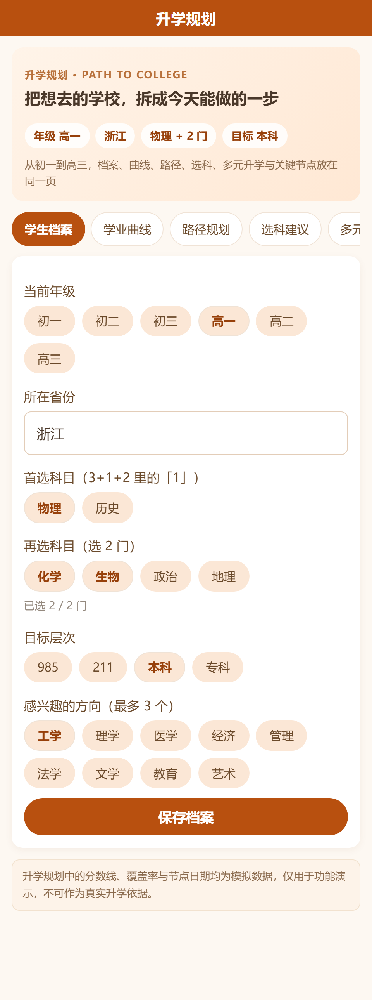
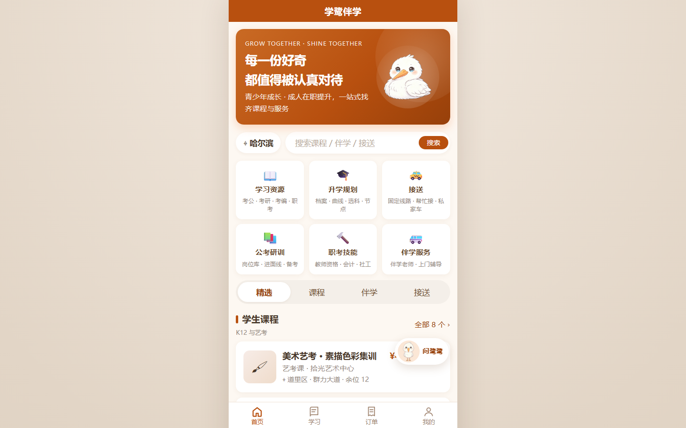

# 学鹭伴学 · 网页版（H5）

由微信小程序源码 `xuelu-miniprogram-cloud` **自动编译**而来的静态网页，
24 个页面、全部业务流程与小程序一致：课程 / 伴学 / 接送 / 学习资源 /
升学规划 / 院校库 / 考公考研考编 / 机构工作台 / 入驻审核 / 订单支付核销 / 学鹭助手。

页面 JS 一行没改，直接把 WXML、WXSS、`wx.*`、`Page/App/setData` 翻译成了浏览器能跑的东西——
所以小程序后续改动，重新构建一次网页版就能同步，不存在「两套代码各改各的」。

> **本仓库只包含网页版工程**：WXML / WXSS 编译器、浏览器运行时、构建脚本，以及已构建好的 `dist/`。
> 微信小程序的原始源码不在本仓库——重新构建时用 `XUELU_SRC` 指向你自己的小程序源码目录即可。

---

## 界面预览

| 首页 | 服务详情 | 升学规划 |
| --- | --- | --- |
|  |  |  |

| 机构主页 | 桌面端（480px 手机视口居中） |
| --- | --- |
|  |  |

---

## 一、快速开始

```bash
git clone https://github.com/w3453194991-afk/xuelu-web.git
cd xuelu-web

# 已经构建好了 dist/，直接起服务看
node tools/serve.mjs          # → http://127.0.0.1:5180

# 改完小程序源码后重新构建
node build.mjs

# 构建 + 起服务
npm run dev

# 一键验证（构建 + 交互流程断言 + 24 页截图查错）
npm run verify
```

`dist/` 里是纯静态文件，丢到 Nginx / OSS / Vercel / GitHub Pages 任意一处即可上线，
不需要 Node 运行时。**建议走 HTTP 访问**（`file://` 直开时 localStorage 行为不稳定）。

构建源目录默认是 `../xuelu-src/xuelu-miniprogram-cloud`，可用环境变量覆盖：

```bash
XUELU_SRC=D:/code/xuelu-miniprogram-cloud node build.mjs
```

## 二、目录结构

```
xuelu-web/
  build.mjs              构建入口：小程序源码 → dist/
  package.json
  src/
    shell.html           页面外壳（导航栏 / tabBar / 浮层容器）
    shell.css            手机视口、导航栏、tabBar、toast/modal/选择器样式
    base.css             WXML 标签 → 小程序盒模型的基础复位
    runtime/
      boot.js            入口：装全局对象 → 跑 app.js → 启动路由
      host.js            页面运行时：Page/App/setData、渲染、事件、路由、导航栏
      wx.js              wx.* 兼容层：存储 / 导航 / 交互 / 选图 / 定位
      ui.js              toast、loading、modal、选择器底部弹层
  tools/
    wxml.mjs             WXML → JS 模板编译器
    wxss.mjs             WXSS → CSS 编译器
    bundle.mjs           零依赖 CommonJS 打包器
    cdp.mjs              无头 Chrome DevTools 协议封装
    serve.mjs            零依赖静态服务器
    flow.mjs             交互流程断言（32 项）
    shoot.mjs            24 页整页截图 + 控制台报错检查
    verify.mjs           上面三件事串起来跑
  dist/                  构建产物（可直接部署）
    index.html app.js app.css assets/
```

## 三、转换是怎么做的

小程序和浏览器之间只差四件事，各用一个编译器解决：

| 差异 | 处理方式 |
| --- | --- |
| **WXML 模板** | `tools/wxml.mjs` 把 WXML 编译成拼字符串的 JS 函数。`wx:if/elif/else` → `if/else`，`wx:for` → `for`，表达式放在 `with (data)` 里求值，裸标识符 `{{city}}` 就和小程序一样解析成 `data.city` |
| **WXSS 样式** | `tools/wxss.mjs` 把 `rpx` 换成 `rem`（1rpx = 0.01rem，根字号 = 视口宽/7.5，桌面端封顶 480px）；`page` 选择器 → 外壳根节点；`image` → `img` |
| **模块系统** | 小程序是 CommonJS，浏览器不支持 `require`。`tools/bundle.mjs` 把所有模块包进工厂函数、按 id 注册，构建期把 `require('...')` 改写成解析后的 id |
| **小程序 API** | `src/runtime/*` 实现 `Page/App/getApp`、`setData`、事件委托、页面栈与哈希路由，以及 `wx.*` 的浏览器等价物 |

几个必须处理、否则会出错的细节：

- **页面样式隔离**：小程序里每页样式天然只作用于本页，网页里所有页面共用一个 document。
  构建时给每页 WXSS 加上 `[data-page-id="pages/xxx/xxx"]` 前缀，否则 `.card` `.field` 这些同名 class 会互相污染。
- **dataset 类型**：HTML 属性只有字符串，`data-id="{{item.id}}"` 会变成 `"3"`，
  而页面里写的是 `s.id === id`（数字）。所以 `data-*` 在构建期合并成一个 JSON 放进 `data-ds`，
  运行期 `JSON.parse` 还原数字 / 布尔 / 对象。
- **重渲染后的焦点**：`setData` 走整页重渲染，输入框会被重建。
  每个交互元素带 `data-el="路径"`，渲染前记录焦点与光标位置、滚动位置，渲染后按同一路径还原。
- **异常吞掉**：小程序里 `{{item.tutor.score}}` 取不到值只是渲染空白，浏览器裸跑会抛 `TypeError`。
  每个表达式都包了一层 `try/catch`。
- **100vh 口径**：小程序的 `100vh` 不含原生导航栏，网页里含。
  WXSS 里的 `100vh` 被改写为 `var(--page-h)`，抵消导航栏（和 tabBar）高度。
- **日期选择器**：`picker mode="date"` 换成原生 `input[type=date]`（移动端即系统日历）；
  `mode="selector"` 换成底部弹层，选中后照常派发 `bindchange`。

## 四、数据存在哪

小程序自带完整的内置数据层（`utils/mock.js`），不需要任何服务器就能跑通注册、下单、支付、
核销、入驻审核、志愿表等全部流程。网页版沿用了它，**数据存在浏览器 localStorage**
（键前缀 `wxstore:`，与小程序 `xuelu.cloud.*` 对应），刷新不丢、换浏览器就没了。

- 平台管理令牌仍是 `xuelu-admin`（`我的 → 平台管理`）。
- 想重置演示数据：浏览器控制台执行
  `Object.keys(localStorage).filter(k=>k.startsWith('wxstore:')).forEach(k=>localStorage.removeItem(k))`，然后刷新。
- localStorage 只有 5 MB 左右，且小程序里上传的照片是 base64 存进去的，传大图可能超限（会打警告降级）。

### 接真实后端

`utils/api.js` 已经是唯一的数据出入口，页面只认 `{ ok, status, data, error }` 这个契约。
把它 `call()` 里的内置数据分支换成 HTTP 请求即可，页面代码完全不用动：

```js
// utils/api.js
if (!useCloud()) {
  // 现在：mock.handle(name, payload)
  // 改成：
  return fetch('/api/' + name, {
    method: 'POST',
    headers: { 'content-type': 'application/json' },
    body: JSON.stringify(payload)
  }).then(r => r.json()).then(result => ({ ok: result.code === 0, status: 200, data: result.data }));
}
```

服务端可以直接复用 `cloudfunctions/` 里的逻辑（`common.js` + 各函数 `index.js` 就是纯 Node 代码，
把 `wx-server-sdk` 的数据库调用换成自己的数据库即可），请求 / 响应结构与云函数一致。

## 五、和小程序的行为差异

| 项 | 说明 |
| --- | --- |
| 微信一键登录 | 网页里没有微信身份，点「微信一键登录」会提示改用手机号 |
| 支付 | 仍是「下单 → 确认 → 生成核销码」的模拟支付，未接微信支付 / 支付宝 |
| 选图 | 换成系统文件选择，并用 canvas 转成 JPEG（与原 `compressImage` 一致，能通过后端的格式校验） |
| 定位 | 保留定位入口，但不会弹系统授权；缺省城市照常显示 |
| 地图 / 分享 / 订阅消息 / 客服 | 未实现（原小程序也没用到地图组件） |
| 返回键 | 用小程序式的导航栏返回按钮，同时兼容浏览器前进后退 |
| 桌面端 | 以 480px 手机视口居中展示（背景带衬底），窗口变窄自动铺满，适合直接投屏演示或挂到官网 |

## 六、自检

`npm run verify` 会依次做三件事，任何一项失败都会以非 0 退出：

1. **构建**：编译 24 页模板，顺带检查 WXML 里绑定的事件处理函数在页面 JS 中是否存在。
2. **交互流程（`tools/flow.mjs`，32 项断言）**：首页 → 详情 → 返回、tab 切换、搜索输入
   （重渲染后焦点与内容保持）、注册登录、下单 → 支付确认弹窗 → 核销码、选择器弹层回写、助手对话。
3. **逐页截图（`tools/shoot.mjs`）**：24 页整页截图存到 `.shots/`，并抓 `console.error` 与未捕获异常。

当前状态：24 页全部渲染正常、无控制台报错，交互流程 32/32 通过。

## 七、已知问题

- 原小程序 `pages/gaokao/gaokao.wxml` 引用了 `assets/ip/mascot-study.jpg`，但压缩包里没有这个文件。
  网页版构建时把它置空（并在构建输出里提示），避免出现 404 和裂图；补上图片即可恢复。
- 页面采用「整页重渲染」策略，单页几十个节点，实测无卡顿；
  如果以后要做长列表无限滚动（数千行），建议改成差量更新。
- 未做 SSR，页面内容由客户端渲染，不利于搜索引擎收录（当前是工具型应用，影响有限）。
